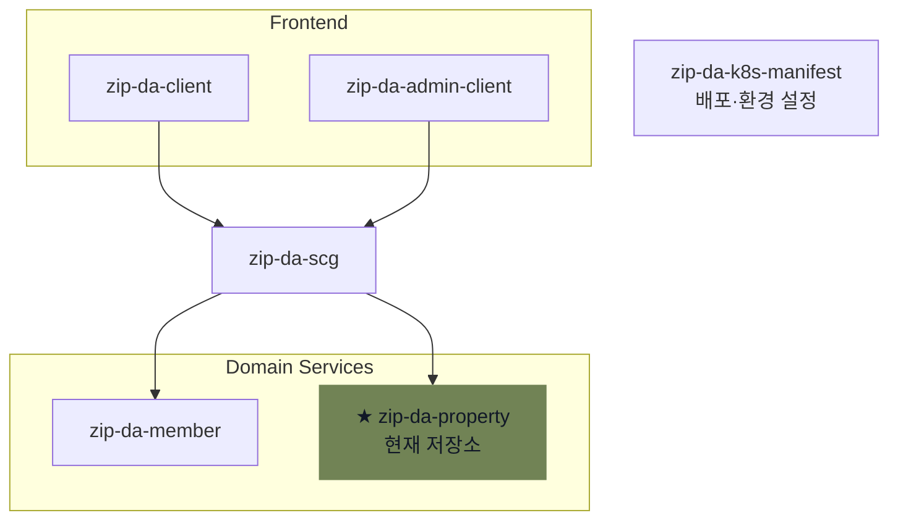

# ZIPDA Property 서비스

> **ZIPDA**는 사용자와 중개사를 연결하고 회원 관리, 중개사 인증, 매물 탐색·관리 기능을 제공하는 **MSA(Microservices Architecture)** 기반 부동산 서비스이다.

`zip-da-property`는 ZIPDA MSA에서 매물 등록·검색·공개, 지역·단지, 이미지, 인증, 찜과 신고 데이터를 담당하는 Spring Boot 서비스이다. 외부 요청은 API Gateway(`zip-da-scg`)를 거치며, Property서비스는 매물 데이터와 업무 정책을 소유한다.

## ZIPDA MSA 구성



## 주요 기능

- 지도 영역과 확대 수준에 따른 지역 집계·매물 위치·가격 마커 조회
- 필터·커서 기반 공개 매물 목록, 상세 조회와 인기 매물 제공
- 매물 등록·수정, 거래·공개 상태 변경, 논리 삭제와 복구
- `Idempotency-Key` 기반 중복 등록 방지와 `If-Match` 기반 동시 수정 충돌 제어
- Kakao 주소 검증과 원본 위치·공개 위치 분리
- MinIO Presigned URL 기반 이미지 업로드와 완료 검증
- 소유자·세입자·중개사 매물 인증, 만료·재인증·증빙 보관 관리
- 주소·가격·이미지·문구를 이용한 허위·중복 등록 위험 평가
- 찜, 신고·이의신청과 관리자 처리 API·이력 관리
- Member 권한 조회와 Property 도메인 이벤트 발행

## 공통 운영 기능

- 변경 revision, 상태 이력과 감사 이벤트 기록
- Hibernate Filter와 AOP 기반 논리 삭제 기본 조회
- 인증 만료·재인증 안내, 증빙·미연결 파일·멱등 키 정리 작업
- `code`, `message`, `data`, `traceId` 공통 응답과 전역 예외 처리
- `X-Trace-Id` 기반 요청·응답 및 쓰기 API 로그 연결

## 기술 스택

| 영역 | 기술 |
| --- | --- |
| 실행 환경 | Java 21 |
| 프레임워크 | Spring Boot 4.1.1, Spring MVC, Spring Security |
| 데이터 접근·저장 | Spring Data JPA, QueryDSL 5.1, Hibernate Spatial, MySQL 8.4 |
| 파일 저장 | MinIO 8.6 |
| 외부 연동 | Kakao Local REST API, Member 내부 API |
| 이벤트 | Spring Kafka |
| API 문서 | springdoc-openapi 3.0.3 |
| 빌드·CI | Gradle Wrapper, GitHub Actions (`bootJar`) |

## 아키텍처 요약

```text
Client / Admin Client
        │ Access Token
        ▼
API Gateway (zip-da-scg)
        │ JWT 검증, X-User-*·X-Trace-Id 전달
        ▼
Property Service
        │
        ├─ MySQL 8.4       매물·지역·이력·운영 데이터
        ├─ MinIO           이미지·검증 증빙
        ├─ Kakao Local API 주소 검색·좌표 검증
        ├─ Member Service  등록·수정 권한 확인
        └─ Kafka           Property 이벤트 발행·조건부 Member 이벤트 수신
```

- Gateway: Access Token 검증과 내부 인증 헤더 생성
- Property: 역할·작성자·매물 상태·버전과 업무 권한 판단
- Member: 매물 등록·수정이 가능한 회원 상태인지 응답
- Kafka: Property 내부 발행 기능은 구현되어 있으며, 다른 서비스와의 전체 이벤트 연동은 V3 예정

Property 포트를 외부에 직접 노출하거나 클라이언트가 보낸 `X-User-*` 헤더를 그대로 신뢰하면 안 된다.

## 문서

| 문서 | 내용 |
| --- | --- |
| [Property 서비스 개요](zip-da-property-doc/01-service-overview.md) | 서비스 목적, 책임 범위, 대표 기능과 기술 스택 |
| [ERD & 데이터베이스](zip-da-property-doc/02-erd-and-database.md) | ERD, 실제 테이블 구성과 데이터 정책 |
| [Property 서비스 아키텍처](zip-da-property-doc/03-architecture.md) | 계층 구조, MSA 경계와 외부·서비스 간 연동 |
| [API 명세](zip-da-property-doc/04-api-specification.md) | Controller 기준 엔드포인트, 권한과 공통 계약 |
| [인증·권한 경계](zip-da-property-doc/05-auth-and-permission.md) | Gateway 인증 헤더, 역할·작성자·Member 권한 확인 |
| [주요 기능](zip-da-property-doc/06-key-features.md) | 검색, 쓰기 동시성, 위치 보호, 파일·인증·신고 처리 |
| [개발 환경 세팅](zip-da-property-doc/07-development-setup.md) | 환경 변수, 기존 DB, 실행·검증과 Kafka 설정 |

## 개발 환경

로컬 환경 변수, `zipda_property` DB, MinIO·Kakao·Kafka 설정과 실행 방법은 [개발 환경 세팅](zip-da-property-doc/07-development-setup.md)을 참고한다.

## API와 응답

- 일반 API: `/api/property/**`
- 관리자 API: `/api/admin/**`
- 일부 기능은 기존 계약에 따라 `/api/properties/**`, `/api/property-files/**`, `/api/property-reports/**` 경로 사용
- 보호 API: `Authorization: Bearer <access-token>`을 Gateway에 전달

공통 응답은 `code`, `message`, `data`, `traceId`를 포함한다. 전체 경로와 권한은 [API 명세](zip-da-property-doc/04-api-specification.md), 실행 시점의 요청·응답 계약은 `/api-docs`를 기준으로 한다.

## OpenAPI

- Property OpenAPI JSON: `/api-docs`
- Property 자체 Swagger UI: 기본 비활성화
- 통합 문서 화면: Gateway에서 Property OpenAPI JSON을 전달받아 구성

로컬 Swagger UI 활성화 방법은 [개발 환경 세팅의 OpenAPI 설정](zip-da-property-doc/07-development-setup.md#5-openapi)을 참고한다.
